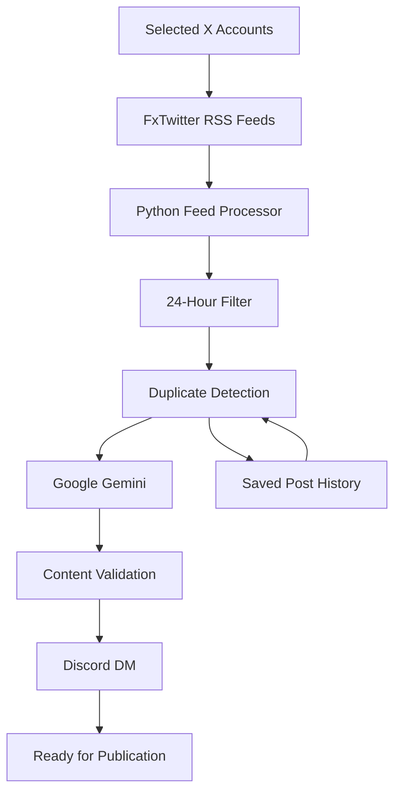

# ANIVO 🌸

### Your personal anime news assistant.

[](https://github.com/Mariam-El-Jarkas/Anivo-bot/actions/workflows/scheduled-check.yml)


**ANIVO** is a personal anime-news assistant designed to make collecting and preparing anime news easier.

It automatically monitors selected anime news sources on X, filters recent posts, transforms useful updates into clear Modern Standard Arabic using Google Gemini, and sends the prepared news directly to a private Discord DM.

Instead of constantly checking multiple accounts and manually preparing every update, ANIVO brings the news to one place, ready for review and publication.

---

## ✨ Features

- **Automated source monitoring:** Checks selected anime news accounts through RSS feeds.
- **Recent news filtering:** Processes posts published within the last 24 hours.
- **AI-powered Arabic rewriting:** Uses Google Gemini to turn source posts into clear, readable Arabic news.
- **Original terminology:** Preserves anime titles, character names, and other relevant names in English.
- **Source attribution:** Includes the original post link with each prepared news item.
- **Duplicate prevention:** Keeps track of previously processed posts to avoid repeated notifications.
- **Content filtering:** Skips posts that do not contain enough information to produce a reliable news update.
- **Private Discord notifications:** Sends prepared news directly to the configured Discord user.
- **Scheduled execution:** Runs automatically through GitHub Actions without requiring a computer or phone to stay online.

## ⚙️ How It Works



1. GitHub Actions triggers the scheduled workflow.
2. ANIVO retrieves posts from the configured RSS feeds.
3. Posts outside the 24-hour window are discarded.
4. Previously processed posts are ignored.
5. Eligible posts are sent to Google Gemini for Arabic rewriting.
6. Posts with insufficient source information are skipped.
7. Successfully prepared news items are delivered to Discord.
8. Processed post IDs are saved to prevent duplicate notifications in future runs.

## 📰 Monitored Sources

ANIVO currently monitors these X accounts:

| Source | Account |
|---|---|
| Anime Therapy | [@animetherapy](https://x.com/animetherapy) |
| Ahmed M. | [@ahmedm94m](https://x.com/ahmedm94m) |
| ASCom | [@ascom0](https://x.com/ascom0) |
| Anime Raku | [@animerakuar](https://x.com/animerakuar) |

Sources are configured in `anivo/sources.py`.

## 🛠️ Tech Stack

| Technology | Purpose |
|---|---|
| Python | Core application and processing logic |
| FxTwitter RSS | Retrieves posts from monitored X accounts |
| Google Gemini API | Arabic news rewriting |
| Discord API | Private news notifications |
| GitHub Actions | Scheduled automation |
| SQLite | Persistent seen-post history and cache |

## 📁 Project Structure

```text
Anivo-bot/
│
├── .github/
│   └── workflows/
│       └── scheduled-check.yml
│
├── anivo/
│   ├── __init__.py
│   ├── sources.py
│   ├── rewriter.py
│   ├── discord_client.py
│   ├── state.py
│   └── run.py
│
├── data/
│   └── anivo.db
│
├── requirements.txt
├── .gitignore
└── README.md
```

### Main Components

- `sources.py` — Fetches and parses RSS feeds from monitored accounts.
- `rewriter.py` — Sends eligible posts to Gemini and handles Arabic news generation.
- `discord_client.py` — Delivers prepared news to Discord.
- `state.py` — Loads and saves previously processed post IDs.
- `run.py` — Coordinates the monitoring, filtering, rewriting, and notification process.
- `scheduled-check.yml` — Defines the automated GitHub Actions workflow.

## 🚀 Automation

ANIVO runs through GitHub Actions.

| Setting | Configuration |
|---|---|
| Execution | Scheduled GitHub Actions workflow |
| Schedule | Every 15 minutes |
| News window | Rolling 24 hours |
| Maximum posts per run | 5 eligible unseen posts |
| Notifications | Private Discord DM |
| State storage | `data/anivo.db` (SQLite) |

The workflow is designed to run automatically in GitHub's hosted environment. No local machine needs to remain online.

ANIVO processes up to five eligible, previously unseen posts per execution to keep each run manageable.

*GitHub Actions scheduling is not guaranteed to start at the exact scheduled minute.*

## 🔐 Configuration

The application uses GitHub repository secrets to protect API credentials.

Configure the required secrets under:

**Repository → Settings → Secrets and variables → Actions**

| Secret | Description |
|---|---|
| `GEMINI_API_KEY` | Google Gemini API key |
| `DISCORD_BOT_TOKEN` | Discord bot authentication token |
| `DISCORD_USER_IDS` | Comma/space-separated Discord recipient IDs |
| `DISCORD_USER_ID` | Legacy fallback for a single Discord recipient |
| `EXTRA_FEEDS` | Optional additional RSS feeds, if supported by the current configuration |

Never commit API keys, bot tokens, or other credentials to the repository.

### Discord recipients and manual rechecks

Set `DISCORD_USER_IDS` to a space-separated or comma-separated list of recipient IDs. It supports the existing `DISCORD_USER_ID` secret as a fallback.

For the supplied friend ID, use:

```text
DISCORD_USER_IDS=<your-user-id>,1574342548288307261
```

No always-on Discord bot or external host is required. GitHub Actions runs:

- Every 15 minutes: source news checks
- Every 30 minutes: recent WitAnime episode checks
- Sunday at 10:00 UTC: Anime Trending weekly report
- Sunday at 09:00 UTC: full anime schedule

You can recheck immediately from GitHub:

1. Open **Actions**.
2. Choose **ANIVO - Weekly Anime Trending report**, **ANIVO - Check WitAnime episodes**, or **ANIVO - Anime schedule**.
3. Select **Run workflow**.

Anime Trending rankings are fetched directly from the public chart pages:

- Top anime: `https://www.anitrendz.com/charts/top-anime`
- Male characters: `https://www.anitrendz.com/charts/male-characters`
- Female characters: `https://www.anitrendz.com/charts/female-characters`

Weekly anime and character reports use English-labeled poster layouts with a week/season header, chart period, Anime Trending ranks, and artwork. The Discord message still contains the short Arabic title and ANIVO signature, followed by the image. Character ranking positions stay within Anime Trending's separate male and female charts. The anime chart ranks series, not individual episode ratings.

The weekly anime schedule is sent in an English-labeled day-card poster with two columns of titles. Schedule sources are tried in order: WitAnime, Jikan, then AniList. AniList covers the next seven days and labels its airing times as UTC; days without listed shows are omitted. If every schedule source is unavailable, the workflow fails visibly instead of reporting a successful run without sending a schedule. WitAnime releases are detected from its public episode sitemap every 30 minutes. `ANIVO_RETENTION_DAYS` defaults to 7, and old seen-post IDs are pruned automatically.

## 📌 Content Guidelines

ANIVO is designed to prepare useful news updates, not blindly rewrite every post.

Its processing rules include:

- Prioritize posts from the most recent 24 hours.
- Preserve original anime titles and relevant names in English.
- Write news in clear Modern Standard Arabic.
- Avoid introducing information that is not supported by the source.
- Skip posts that lack sufficient information.
- Retain the original source link for attribution.
- Avoid sending the same post repeatedly.

Prepared updates are intended for review before publication.

## ⚠️ Limitations

- RSS feed availability depends on the external feed provider.
- Temporary feed errors may prevent a source from being checked during a particular run.
- GitHub Actions schedules can experience delays.
- AI-generated text can require manual correction or verification.
- The bot depends on the availability and usage limits of its external APIs.
- Only configured sources are monitored.

## 🔮 Future Improvements

Potential improvements include:

- More reliable RSS retrieval and retry handling.
- Better preservation of original source images.
- Improved detection of duplicate news reported by different accounts.
- Additional content classification and filtering.
- More flexible source management.

## 🌸 Identity

**ANIVO || أنيفو**

A personal tool built to make anime-news monitoring and preparation simpler, faster, and more convenient.

---

<sub>Built with Python, Google Gemini, Discord, and GitHub Actions.</sub>
